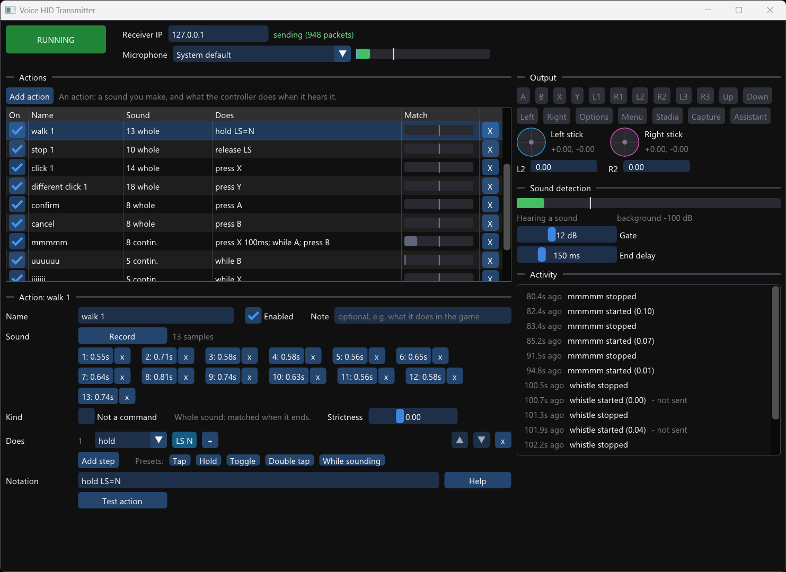

# Voice HID Transmitter

This is a Windows application that generates synthetic gamepad inputs based on sounds it hears through your computer's microphone. You can define a list of actions and record the sounds that should trigger them.

The actions can be one-shot ("tap X when I say _fire_") or continuous ("keep holding A for as long as I'm whistling"). The sounds can be words, but can also be tongue clicks, humming, hissing, etc., as long as they're distinct enough for the program to tell them apart.

It acts as the Transmitter component of a [HID Forwarder](https://github.com/jfedor2/hid-forwarder) setup. The gamepad inputs generated are sent to the configured Receiver. This way you can control a game on the same PC or on a separate computer or console.

## Usage

- **RUNNING / STOPPED** turns sending inputs on and off.
- **Receiver IP**: the address of the receiver. Inputs go to UDP port 42734.
- **Microphone**: "System default" follows the Windows default recording device, or pick a specific one. The meter shows the level, the background noise level (blue) and the level a sound must exceed to count (white).

Each **action** is a sound and what the virtual controller does when it hears it:

- **Name**, to tell actions apart, and an optional **Note**.
- **Sound**: click **Record**, then make the sound, pause, make it again... Each sound becomes a sample. 3 to 5 samples work best. Samples can be played back and deleted.
- **Does**: the steps the action runs, in order. Each step has a verb (press, hold, release, toggle, while, wait, release all), its targets and, for press and wait, a time.
  - Click a target to change it in a picker with the buttons, a direction pad for each stick (with a deflection slider) and partly pulled triggers. **+** adds a target used at the same time; right-click removes one.
  - The arrows reorder steps; **Add step** adds one.
  - **Presets** (Tap, Hold, Toggle, Double tap, While sounding) replace the steps, keeping the first target.
- **Notation**: the same steps as text (see below). Edit either one; they stay in sync.
- **On** (the checkbox in the list) and **Enabled**: when off, the action is left out completely, as if it didn't exist. Its recordings are kept.
- How the sound is matched follows from what the action does:
  - **Whole sound** (most actions): matched when the sound ends. Best for words and clicks.
  - **Continuous** (actions that use `while`): matched while the sound lasts. The action starts ~150 ms into the sound, and `while` steps last until the sound stops. Best for whistles, hums and hisses.
- **Not a command**: sounds like this action's samples won't trigger any action. Record here whatever keeps triggering actions by mistake, like a word you say a lot, or a noise.
- **Strictness**: a sound triggers the action it's closest to, if it's closer to it than to anything else by this much. "Anything else" means:
  - the other actions;
  - a built-in set of common words and noises;
  - parts of your own recordings, like the "ft" of "left" on its own;
  - actions marked "Not a command".

  The default, 0, means just closer. The **Match** column shows the difference for the last sound heard, with the setting as a white line. Raise it if the action triggers on the wrong sounds, lower it if it doesn't trigger.
- If some of an action's samples sound more like another action's samples than like each other, the action panel says so and marks them in orange. Delete them and record new ones.
- **Test action** runs the action as if you made the sound (for continuous actions, for as long as you hold the button).

Under **Sound detection**, **Gate** is how much louder than the background a sound must be, and **End delay** is how much quiet ends a sound. Whole sounds are matched when they end, so a shorter delay is faster. But words with pauses in them ("stop" has a short silence before the "p") need enough delay to stay in one piece.

Settings and actions are saved automatically to `%APPDATA%\voice-hid-transmitter\voice-hid-transmitter\settings.json`, and recorded samples to the `samples` folder next to it, as WAV files.

Pass `--start` on the command line to start in the running state.

## Notation

The text form of an action's steps. It's what's saved, and it can be typed directly instead of using the step editor. An action is one or more steps separated by `;`, run in order.

| Step | Meaning |
|---|---|
| `press A` | Press, release after 100 ms, then go on. |
| `press A+B 200ms` | Several targets at once, for a given time (`ms` or `s`). |
| `hold X` | Press and keep held. |
| `release X` | Let go. A stick goes back to center, a trigger to 0. |
| `release all` | Let go of everything and stop all running actions. |
| `toggle L3` | Hold if not held, otherwise release. |
| `while A` | Hold for as long as the sound lasts (continuous sounds). |
| `wait 150ms` | Pause before the next step. |

`press` and `wait` delay for their duration before the next step. All other steps except `while` are instant.

| Target | Meaning |
|---|---|
| `A B X Y L1 R1 L2 R2 L3 R3` | Buttons (`L2`/`R2` fully pressed). |
| `UP DOWN LEFT RIGHT` | D-pad. |
| `OPTIONS MENU STADIA CAPTURE ASSISTANT` | The other Stadia controller buttons. |
| `LS=NE`, `RS=N*0.5` | Stick in a direction (`N NE E SE S SW W NW`, `C` = center), optionally partly deflected. `N` is up. |
| `LS=(0.3,-1)` | Stick at an exact position, `+y` = up. |
| `L2=0.5` | Analog trigger travel, 0 to 1. |

Examples: `press A; wait 100ms; press A` (double tap), `hold LS=N; press A` (run and jump), `while RS=E` (look right while whistling), `toggle R2=0.5`.

Buttons from all actions combine. A stick or analog trigger takes the most recent position given to it, and when that ends (a timed `press`, or a `while` whose sound stopped) the previous one comes back if it's still held. Triggering an action that's still running restarts it.

The parser also accepts some aliases (`LB`, `RT`, `START`, `SELECT`, `HOME`, `LEFTSTICK`, `NORTHEAST`, `tap`, `for 2 seconds`, ...) and lowercase, and shows the canonical form.

## How it works

- **Whole sounds** are matched when they end, as vectors combining two things:
  - **What was said.** A [speech embedding](https://www.kaggle.com/models/google/speech-embedding) model by Google (Apache-2.0, in the form [openWakeWord](https://github.com/dscripka/openWakeWord) uses) turns ~0.8 s of the sound into 96 numbers. It was trained on many speakers and recording conditions, so where the microphone is and how loud you are matter little. It runs on the CPU in a few milliseconds, with a small built-in implementation, so there's no extra runtime or DLL.
  - **The sound's spectral shape.** These are statistics of the cepstra of its loud frames, and they tell apart sounds the speech model doesn't know well, like different tongue clicks.

  The sound is compared, by cosine similarity, with every action's samples and with examples of things that aren't commands:
  - **Common words and noises:** 300 words spoken by the Windows text-to-speech voices, plus breaths, bursts, clicks and bumps (`models/sound_background.bin`, made by `tools/make_background.ps1`).
  - **Parts of your recordings:** the start, the end, and (for longer sounds) the recording backwards.
  - **Actions marked "Not a command".**

  A built-in example that's as close to an action's samples as they are to each other is left out, so a command that happens to be a common word works. The sound triggers the action it's closest to, if it's closer to it than to anything else by the action's strictness. So actions are told apart by what makes them different, and sounds that aren't particularly close to any action trigger nothing.
- **Continuous sounds** are matched the same way, but while they last. Every 50 ms, what has been heard so far is matched: the first 50, 100, ... 700 ms, after that the last 500 ms. It's matched against the same kinds of pieces of the samples. Here, "not a command" also includes the other actions' sounds and the starts of common words, so a word starting with "s" doesn't start an "sss" action. An action starts when it wins 3 times in a row, which is ~150 ms into the sound. It stops when the sound goes quiet, or when something else wins for 200 ms.

Listening takes a fraction of one CPU core. Matching takes a few milliseconds when a sound ends, and every 50 ms during a sound when there are continuous actions.

## Limitations

- Recognition is speaker dependent: record the samples yourself. Samples recorded with a different voice won't match well.
- Hisses that differ mostly above 4 kHz, like "s" and "sh", are hard to tell apart: the speech model only hears up to 3.8 kHz.
- Sounds need a short pause between them. Two whole sounds without a gap, or a click during a whistle, are heard as one sound.
- Game audio from speakers reaches the microphone. Use headphones.
- Only one continuous sound is active at a time.

## License and acknowledgements

The software in this repository is licensed under the [MIT License](LICENSE).

The sound recognition uses Google's [speech embedding](https://www.kaggle.com/models/google/speech-embedding) model (originally published on TFHub), licensed under the [Apache License 2.0](https://www.apache.org/licenses/LICENSE-2.0). `models/speech_embedding.bin` was converted to this project's own format from the ONNX version distributed by [openWakeWord](https://github.com/dscripka/openWakeWord) (v0.5.1); it's built into the executable.

The UI uses [Dear ImGui](https://github.com/ocornut/imgui) (MIT) and configuration uses [nlohmann/json](https://github.com/nlohmann/json) (MIT).